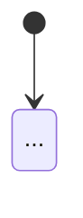
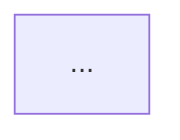

<h1 align="center"> Public Archive Specs </h1>

How I prepare a finished project before making its repo a **public archive** on GitHub. Follow this exactly for every project, without asking me to explain it again.

### Purpose

A public archive is a finished, read-only project kept as a portfolio piece. Nobody will install, run, maintain or contribute to it. Its docs exist to **show the work** to two kinds of reader:

| File | Reader | Goal |
|---|---|---|
| `README.md` | Non-technical people: recruiters, clients, the people it was built for | See what the system does and what problem it solves, through plain language and screenshots |
| `DEVDOCS.md` | Technical people: developers, engineers reviewing my portfolio | Understand how the system works and why it was designed that way |

Because nobody runs it, **neither file has install, setup, deployment, environment or contribution steps.**

### Files

```
<repo>/
├── README.md            non-technical preview
├── DEVDOCS.md           technical explanation
├── docs/
│   ├── demo-img-01.png  landing / sign-in screen
│   ├── demo-img-02.png  first feature screen
│   ├── demo-img-03.png  ...
│   └── demo-img-NN.png
└── public/              (web apps; otherwise the repo root)
    ├── logo-01.png      the icon only
    └── logo-02.png      the icon with the product name
```

### Logos

- **`logo-01`** is the icon only (square, transparent background). Use it where space is square or small: browser tab icon, sign-in mark, error pages.
- **`logo-02`** is the icon with the product name (wide, transparent background). Use it at the top of `README.md` and `DEVDOCS.md`, and in the app's navbar and admin panel.
- Trim empty transparent space around `logo-02` so it sits properly in a navbar.
- In web apps both live in `public/` so the app can serve them.

### Screenshots

- Put them in `docs/` at the repo root, and nothing else in that folder.
- Name them `demo-img-01.png`, `demo-img-02.png`, ... **My numbering is the display order.** Never rename or reorder them. Match each file to its README section by number, and look at the image if unsure.
- `demo-img-01` is always the landing or sign-in screen. It sits under the README intro with no heading.
- Each later image gets its own README section.
- Use realistic demo data in screenshots (seeded people, documents, numbers), never empty states. Check that no private or sensitive content is visible.
- Keep `docs/` out of production builds (for example in `.dockerignore`).

### README.md

**Tone:** plain language for non-technical readers. No code, file paths, diagrams, tables, tech stack, install steps or jargon.

**Layout,** in this exact order:

1. The centred `logo-02`, linking to `DEVDOCS.md`.
2. One intro paragraph in a `<p>` tag, following this pattern: *"A [kind of system] developed to automate [what], replacing [manual process] with [online solution]. The system allows [user group] to [main tasks], and gives/provides [other group] with the tools to [their tasks]."*
3. `demo-img-01` (landing or sign-in), with no heading.
4. One section per remaining screenshot, each as:
   - a `###` heading naming the screen (a noun phrase, Title Case, for example *Admin Dashboard*, *Document Review*)
   - a paragraph opening *"The [Section Name] …"* that says what it lets people do and what manual work it replaces or makes easier
   - **then** the screenshot. The text always comes before the image.

Every image is written as `[](docs/demo-img-NN.png)`, so clicking it opens the full-size file.

**Template:**

```markdown
<div align="center">

[](DEVDOCS.md)

</div>

<p>A <kind of system> developed to automate <what>, replacing <manual process> with <online solution>. The system allows <users> to <tasks>, and gives <admins/other group> the tools to <tasks>.</p>

[](docs/demo-img-01.png)

### <Screen Name>

The <Screen Name> <does what, for whom>. It replaces <manual work> with <what>, making <benefit>.

[](docs/demo-img-02.png)

### <Screen Name>

The <Screen Name> ...

[](docs/demo-img-03.png)
```

**Reference:** [portfolio-and-automated-ranking-app](https://github.com/elijah-alonzo/portfolio-and-automated-ranking-app) and `document-processing-app`.

### DEVDOCS.md

**Tone:** explains the system to an engineer: what it does, how it works, and why it was built that way. It is an explanation, not a setup guide or a code reference. Prefer short prose around diagrams. Name a class or file only when it helps the explanation.

**Never include:** install or setup steps, commands, environment variables, deployment, demo accounts or passwords, rebranding steps, contribution rules.

**Headings:** plain `###` (heading 3), left-aligned. Don't centre them.

**Sections,** in this order:

1. **Header:** the centred `logo-02`, linking back to `README.md`. No text title.
2. **Overview:** the real-world problem, the core idea of the solution, and the main parts or screens and who uses each.
3. **How It Works:** the main flow from start to finish as numbered steps (what the user does, what the system does, who is notified), followed by a diagram of it (state or flow diagram). State plainly what the MVP does *not* do where a reader might expect it.
4. **Architecture:** a system diagram of who uses what, and how the parts connect, then one paragraph on how the backend and frontends fit together. Add a sequence diagram of one key request. End with **Key decisions**: bullet points, each a bold one-line decision followed by *why*.
5. **Domain Model:** an ER diagram plus a `Concept | Meaning` table in plain words.
6. **Permissions:** who can do what, as a `Who | Can` table.
7. **Supporting features:** notifications, audit logs, dashboards, integrations: whatever the project has, and how each works. Name the section after its contents (for example *Notifications and Audit*).
8. **Stack:** a `Layer | Technology` table with major versions, taken from the dependency files.
9. **Project Map:** an annotated folder tree of the main directories. This goes last, because it matters to someone reading the code, not to someone understanding the system.

Leave out sections that don't apply. Keep every claim true to the code: check behaviour in the code before describing it, and never describe a feature that doesn't exist.

**Diagrams:** Mermaid code blocks (`flowchart`, `stateDiagram-v2`, `sequenceDiagram`, `erDiagram`). GitHub renders them.

**Template:**

````markdown
<div align="center">

[](README.md)

</div>

### Overview

<The problem in the real world.> <Project> replaces that with <solution>.

The core idea is <one key idea, in bold>. <What it means in practice.>

The system has <N> parts:

- **<Part>** (`/path`), where <who> <does what>.
- **<Part>** (`/path`), where <who> <does what>.

### How It Works

1. **<Step>.** <What happens.>
2. **<Step>.** <What happens.>



### Architecture



<How the backend and frontends fit together.>

```mermaid
sequenceDiagram
    ...
```

**Key decisions**

- **<Decision>.** <Why.>

### Domain Model

```mermaid
erDiagram
    ...
```

| Concept | Meaning |
|---|---|

### Permissions

| Who | Can |
|---|---|

### <Supporting Features>

### Stack

| Layer | Technology |
|---|---|

### Project Map

```
<annotated tree>
```
````

**Reference:** `document-processing-app/DEVDOCS.md`.

### Checklist Before Archiving

- [ ] `public/logo-01.png` and `public/logo-02.png` exist, and the app uses the right one in each place.
- [ ] Screenshots are in `docs/` as `demo-img-NN.png`, in my order, showing realistic demo data and nothing private.
- [ ] README follows the layout: logo linking to DEVDOCS, `<p>` intro, `demo-img-01`, then heading, paragraph and image for each screen.
- [ ] README has no technical content.
- [ ] DEVDOCS follows the section order, has no setup or deployment content, and every claim matches the code.
- [ ] The two logos link README ↔ DEVDOCS.
- [ ] Sample files committed to the repo (seed documents, fixtures) contain nothing private.
- [ ] No other docs (CLAUDE.md, tests, code comments) still mention old file names.
- [ ] Commit messages follow my convention: `Feat|Fix|Mainte|Docs: message`.
- [ ] Then archive the repo on GitHub (Settings → Archive this repository).
